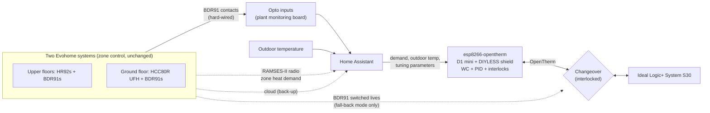

# OpenTherm Boiler Control with ESPHome: Modulating, PID-Trimmed Flow Temperature Alongside Two Evohome Controllers (Design Stage)

**Moving a system boiler from on/off switching to modulating flow-temperature control over OpenTherm, the way a BMS controls a plant room: a dedicated controller drives the boiler with a weather-compensated, PID-trimmed setpoint, while zone control (two Honeywell Evohome systems) becomes an input. The design works around Evohome's one-controller-per-boiler OpenTherm limit, keeps a hard-wired fall-back to the existing BDR91 control, and is set out as a commissioning plan with tests, metrics and use cases.**

> **The short version:**
> - **Today:** four Evohome BDR91 relays switch the boiler on and off at whatever flow temperature its dial is set to.
> - **The plan:** a DIYLESS OpenTherm master shield on a dedicated ESP8266 node becomes the boiler's **only controller**. Its flow setpoint comes from **weather compensation + a PID trim** driven by zone demand, with **DHW priority**, **anti-cycling** and **safe fall-backs**.
> - **Evohome stays** for room and zone control. Its demand is read three ways: **hard-wired** (opto inputs on every BDR91), **RAMSES-II** radio (per-zone heat demand) and the **cloud** (back-up).
> - **An interlocked changeover** switches the boiler between OpenTherm control and the original BDR91 switched lives, so the house is never left without heating.
>
> **Status:** design. The node hardware is assembled (shield orientation proven); boiler connection, firmware and tuning are still to come. Docs 08-10 are templates for the results.

**Portfolio position:** Automation level · plant control strategy. Built on: [Heating plant monitoring](https://github.com/the-control-cabinet/heating-plant-monitoring-esphome) (opto demand inputs, flow/return, boiler state) · [Evohome & RAMSES-II](https://github.com/the-control-cabinet/evohome-heating-controls-ramses-integration) (zone demand)

---

## Architecture

## Documents

| Doc | Contents | Status |
|---|---|---|
| [01 Why OpenTherm, and the constraints](docs/01-why-and-constraints.md) | On/off vs modulation; the one-controller limit; why HA is the master | Design |
| [02 Hardware: node build](docs/02-hardware-node.md) | DIYLESS shield + D1 mini, orientation proof, soldering, enclosure | Assembled |
| [03 Boiler side: Ideal Logic+ S30](docs/03-boiler-connection.md) | OpenTherm terminals, the link, safety, connection steps | Design (verify on site) |
| [04 Firmware and Home Assistant](docs/04-firmware-and-ha.md) | Node YAML, entities, what the boiler reports | Design |
| [05 Evohome integration](docs/05-evohome-integration.md) | Demand from opto, RAMSES-II and cloud; Evohome settings | Design |
| [06 BDR91s and the changeover](docs/06-bdr91-and-changeover.md) | What happens to the switched lives; interlock; fail-safe | Design |
| [07 Control strategy](docs/07-control-strategy.md) | Weather compensation, PID trim, DHW priority, anti-cycling | Design |
| [08 PID tuning](docs/08-pid-tuning.md) | Method, step tests, parameter log | Template |
| [09 Commissioning and tests](docs/09-commissioning-tests.md) | Test plan with pass criteria | Template |
| [10 Outcomes and use cases](docs/10-outcomes-and-use-cases.md) | Metrics before/after; scenarios; constraints | Template |

## Roadmap
- [x] Design and decision record
- [x] Node hardware: D1 mini + DIYLESS shield (orientation proven from the PCB tracks)
- [ ] Bench test: node online, OpenTherm library running, no boiler connected
- [ ] Monitoring baseline (on/off control) captured for comparison
- [ ] Boiler connection + changeover relays; first OpenTherm read-only session
- [ ] Control live: weather compensation only, then PID trim
- [ ] Tuning, commissioning tests, before/after report

## Skills demonstrated (as built)

| Skill | Evidence |
|---|---|
| Control strategy design | Weather compensation + PID trim + DHW priority + anti-cycling |
| Integration under constraints | Two zone controllers, one boiler; multiple demand paths |
| Fail-safe design | Interlocked changeover, safe defaults, stale-input handling |
| Protocol | OpenTherm master implementation |
| Commissioning | Test plan with pass criteria; tuning log; before/after metrics |

📺 [The Control Cabinet on YouTube](https://www.youtube.com/channel/UC5Cupmz7vlfcodpCX7k8iuQ)

*Built and documented by James · part of [The Control Cabinet BMS portfolio](https://github.com/the-control-cabinet). MIT Licence.*
