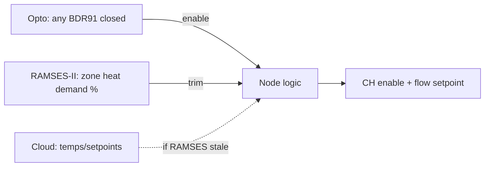

# 05 · Evohome Integration: Demand Without Control

[← Back to README](../README.md)

Evohome keeps full **zone** control (room setpoints, schedules, HR92s, UFH). What changes is that its BDR91s **no longer switch the boiler** in OpenTherm mode. Their states, and each zone's heat demand, become inputs.

## Three demand paths

| Path | What it gives | Strength | Weakness | Role |
|---|---|---|---|---|
| **Hard-wired opto inputs** (plant monitoring board) | Each BDR91 contact: radiators, UFH, cylinder L, cylinder R | Direct, fast, independent of radio and cloud | On/off only | **Primary**: "is anything calling?" |
| **RAMSES-II** (local radio, ramses_cc) | Per-zone **heat demand %**, setpoints, temperatures, BDR91 states | Rich, local, proportional | Radio and gateway dependent | **Trim**: how hard to heat |
| **Cloud** (Evohome integration) | Zone temperatures and setpoints | Independent of the gateway | Slow, internet dependent | **Back-up** for RAMSES |

## Evohome settings to review
| Setting | Today | With OpenTherm control |
|---|---|---|
| BDR91 control mode (TPI / on-off) | TPI cycling | Leave, or set on/off: in OpenTherm mode the contacts only *signal* demand (TPI cycling would make the opto signal pulse; filter it on the node) |
| Boiler cycle rate / minimum on-time | Evohome default | Irrelevant in OpenTherm mode (anti-cycling is on the node) |
| DHW (cylinders) | BDR91 per cylinder | Unchanged: cylinder demand comes in via opto; the node applies DHW priority |
| Zone setpoints and schedules | Evohome | Unchanged |

## Design note: why both controllers can coexist
Neither Evohome controller talks OpenTherm. Each still sees its own BDR91s and zones, exactly as today, so neither knows anything changed. The node simply **listens** to both and owns the boiler.
