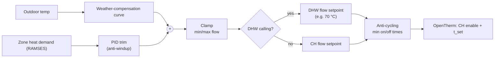

# 07 · Control Strategy

[← Back to README](../README.md)

## 1. Enable
- CH enable = **any demand** (radiators, UFH or either cylinder) **and not** inhibited (manual off, fault).
- Demand is debounced (e.g. 60 s), so TPI pulses from the BDR91s don't cycle the boiler.

## 2. Weather compensation (base setpoint)
A straight line between two points, tuned by observation:

| Outdoor | Flow setpoint |
|---|---|
| −3 °C (design day) | 65 °C ⟨tune⟩ |
| +16 °C | 35 °C ⟨tune⟩ |

Clamped to **30-70 °C** for CH. The UFH has its own mixing valve, so radiator needs set the upper end.

## 3. PID trim
- **Process variable:** a demand signal from Evohome (the maximum, or a weighted mean, of the zone heat-demand percentages via RAMSES), or the room error of a reference zone.
- **Output:** ±10 °C added to the weather-compensation setpoint.
- **Anti-windup:** integral clamped; frozen while the output is saturated, while DHW has priority, and while the boiler is off.
- Runs slowly (e.g. a 60 s sample): a building is a slow process.

## 4. DHW priority
When either cylinder calls, the setpoint goes to the **DHW flow temperature** (e.g. 70 °C) until the cylinder is satisfied. Radiator and UFH demand wait or share as the zone valves allow.

## 5. Anti-cycling
- Minimum burn: e.g. 10 min; minimum off: e.g. 5 min (unless DHW calls).
- If modulation sits at minimum and flow overshoots, reduce the setpoint before allowing an off-cycle.

## 6. Limits and safety
- **The boiler's own limits always apply** (high limit, its maximum CH setpoint).
- **Frost protection:** if the outdoor temperature is under 3 °C and there's no demand for 2 h, enable at a low setpoint briefly (or leave this to Evohome/boiler frost features ⟨decide⟩).
- **Stale inputs:** see [doc 04](04-firmware-and-ha.md).
